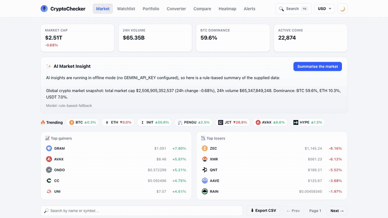

# CryptoChecker

A full-stack cryptocurrency market dashboard: live prices, interactive charts, a
watchlist, portfolio tracking, price alerts, currency switching, and **AI-generated
market insights**.

[](docs/demo.mp4)

▶ [Watch the full 19-second demo with sound](docs/demo.mp4)

- **Frontend:** React 18 + Vite, **Redux Toolkit** + **RTK Query**, React Router, Recharts
- **Backend:** **Python / Django + Django REST Framework**, **PostgreSQL**
- **GenAI:** Google Gemini (with a deterministic offline fallback) for market / coin / portfolio insights
- **Infra:** Docker + docker-compose, Azure-ready (App Service / Container Apps), WhiteNoise + Gunicorn
- **Tests:** pytest (backend) and Vitest + React Testing Library (frontend)

---

## Architecture

```
React (Vite) ── RTK Query / axios ──► Django REST API ──► PostgreSQL
      │                                      │
      │                                      ├─► CoinGecko (proxied + cached server-side)
      └─ Redux Toolkit (theme, currency,     └─► Gemini GenAI (market/coin/portfolio insights,
         watchlist, portfolio, alerts)           cached in Postgres, offline fallback)
```

Why this shape:

- **The browser never calls CoinGecko directly.** Django proxies and caches market
  data, so we control rate limits, can persist price history, and keep API keys server-side.
- **User state is persisted server-side.** Watchlist, portfolio, and alerts moved
  from `localStorage` into PostgreSQL, scoped to a per-browser `X-Session-Key`
  header (swap this for real auth by changing one function, `markets/utils.get_session_key`).
- **State management is Redux Toolkit + RTK Query.** UI state (theme, currency)
  lives in slices; server state (markets, watchlist, portfolio, alerts, insights)
  lives in an RTK Query API slice with tag-based cache invalidation.

### State migration (Context → Redux)

The app originally used React Context for all state. It was migrated to Redux
Toolkit **without rewriting every consumer**: the old hooks (`useWatchlist`,
`usePortfolio`, `useAlerts`, `useCurrency`, `useTheme`) were rewritten as thin
wrappers over Redux/RTK Query that preserve their original return shape. This is
a low-risk, incremental refactor pattern.

---

## Running locally

### Option A — docker-compose (Postgres + API + web)

```bash
# optional: export GEMINI_API_KEY=... for real AI insights
docker compose up --build
# Frontend: http://localhost:8080   API: http://localhost:8000/api/health
```

### Option B — run each piece directly

**Backend**

```bash
cd backend
python -m venv .venv && source .venv/bin/activate
pip install -r requirements.txt
cp .env.example .env            # set DATABASE_URL, or leave unset for SQLite
python manage.py migrate
python manage.py runserver 8000
```

**Frontend**

```bash
npm install
npm run dev                     # http://localhost:5173 (proxies /api → :8000)
```

---

## API

Market data (proxied + cached):

| Method | Path                       | Description                    |
| ------ | -------------------------- | ------------------------------ |
| GET    | `/api/health`              | Liveness check                 |
| GET    | `/api/markets`             | Paginated market list          |
| GET    | `/api/coins/{id}`          | Coin detail                    |
| GET    | `/api/coins/{id}/chart`    | Historical chart               |
| GET    | `/api/global`              | Global market stats            |
| GET    | `/api/trending`            | Trending coins                 |
| GET    | `/api/search?q=`           | Search                         |
| GET    | `/api/simple-price`        | Spot prices for ids            |

Persisted user state (`X-Session-Key` header):

| Method       | Path                       | Description         |
| ------------ | -------------------------- | ------------------- |
| GET/POST     | `/api/watchlist`           | List / add watch    |
| DELETE       | `/api/watchlist/{coinId}`  | Remove watch        |
| GET/POST     | `/api/portfolio`           | List / upsert holding |
| DELETE       | `/api/portfolio/{coinId}`  | Remove holding      |
| GET/POST     | `/api/alerts`              | List / create alert |
| DELETE       | `/api/alerts/{id}`         | Remove alert        |

GenAI insights:

| Method | Path                        | Description                    |
| ------ | --------------------------- | ------------------------------ |
| GET    | `/api/insights/market`      | Market summary                 |
| GET    | `/api/insights/coin/{id}`   | Single-coin analysis           |
| POST   | `/api/insights/portfolio`   | Portfolio analysis (from held) |

Insights are cached in PostgreSQL (`InsightCache`) keyed by a hash of their
inputs, and degrade to a rule-based summary when `GEMINI_API_KEY` is unset.

---

## Tests

```bash
# Backend
cd backend && source .venv/bin/activate && pytest

# Frontend
npm test
```

Backend tests mock CoinGecko so they run offline and deterministically;
GenAI runs in its fallback path.

---

## Deploying to Azure

The backend `Dockerfile` binds Gunicorn to `$PORT` and runs migrations on start,
so it drops straight into **Azure App Service (containers)** or **Azure Container
Apps**. Pair it with **Azure Database for PostgreSQL** and set:

- `SECRET_KEY`, `DEBUG=False`, `ALLOWED_HOSTS=<your-host>`
- `DATABASE_URL=postgres://...`
- `CORS_ALLOWED_ORIGINS=https://<frontend-host>`
- `GEMINI_API_KEY=...` (optional)

Build/push example:

```bash
az acr build -r <registry> -t cryptochecker-api:latest ./backend
az acr build -r <registry> -t cryptochecker-web:latest \
  --build-arg VITE_API_URL=https://<api-host> -f Dockerfile.frontend .
```

---

## Environment variables

See `backend/.env.example`. Key ones: `DATABASE_URL`, `CORS_ALLOWED_ORIGINS`,
`COINGECKO_API_KEY`, `GEMINI_API_KEY`, `MARKET_CACHE_TTL`.
